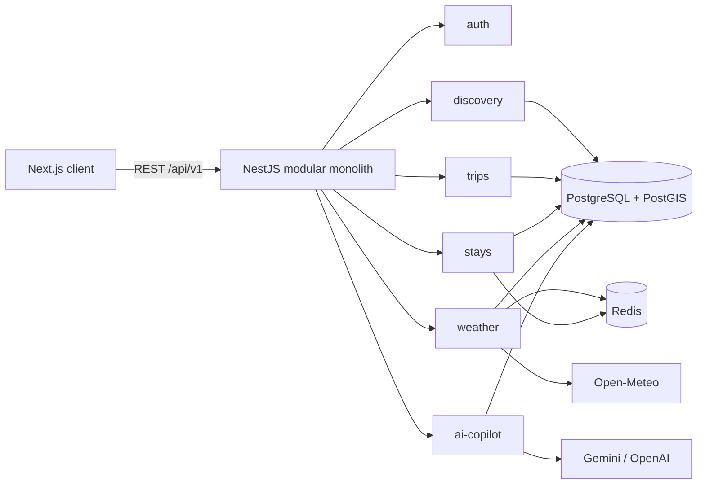
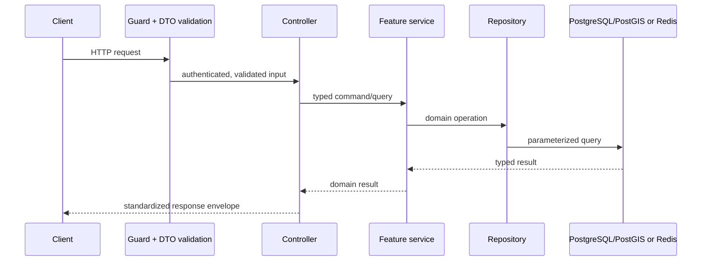
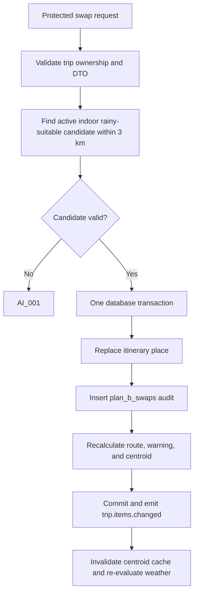
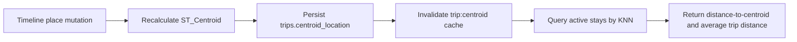

# SkyRoute Backend Architecture

## System overview

SkyRoute is a NestJS v11 feature-based modular monolith. Features remain in one deployable while sharing an in-process transaction boundary for timeline, weather, spatial, and Plan B workflows. Modules may be extracted later only when a measured load or ownership boundary requires it.



The REST contract is [API_SPEC.md](../../share/API_SPEC.md); the persisted model and spatial indexes are [DATABASE.md](../../share/DATABASE.md). Neither is duplicated by controller-local types.

## Runtime composition

```text
src/
├── main.ts                         # bootstrap, global pipe/filter/interceptor, Swagger
├── app.module.ts                   # imports core and feature modules
├── config/                         # typed database, Redis, JWT, weather, and AI config
├── core/
│   ├── database/                   # TypeORM datasource and migrations
│   ├── cache/                      # Redis module and cache abstraction
│   ├── integrations/               # OpenMeteoClient, LlmFunctionCallingClient
│   └── logger/                     # structured logging
├── shared/
│   ├── decorators/                 # @CurrentUser, @Roles, @Public
│   ├── filters/                    # AllExceptionsFilter
│   ├── guards/                     # JWT, role, and trip-owner guards
│   ├── interceptors/               # response transform and request logging
│   ├── pipes/                      # validation and coordinate parsing
│   ├── types/                      # API envelope, coordinates, pagination
│   └── utils/                      # stateless geo, time-slot, and hash helpers
└── features/
    ├── auth/ discovery/ stays/ trips/ weather/ ai-copilot/
    └── <feature>/{dto,entities,repositories,services,tests}/
```

Global modules are `ConfigModule`, database, cache, `ScheduleModule.forRoot()`, and `EventEmitterModule.forRoot()`. `main.ts` registers the validation pipe, exception filter, and transform interceptor once.

## Feature modules and public contracts

| Module | Owns | Exports | Events consumed / emitted |
|---|---|---|---|
| `auth` | users, refresh tokens, JWT session lifecycle | `AuthService` | — |
| `discovery` | places, radar, food recommendations | `DiscoveryService` | — |
| `trips` | trips, itinerary items, distance and centroid trigger | `TripsService`, `TimelineService` | emits `trip.items.changed` |
| `weather` | cache, forecast snapshots, cron, conflict detection | `WeatherService` | consumes `trip.items.changed` |
| `stays` | stay catalogue and centroid-nearest query | `StaysService` | consumes `trip.items.changed` to invalidate cache |
| `ai-copilot` | tool calling, ranking, Plan B audits | `AiCopilotService` | emits `trip.items.changed` after successful swap |

Features import only another feature's module and inject its exported service. Importing internal DTOs, entities, repositories, or helpers is forbidden. Use events for asynchronous consequences to avoid `forwardRef()` circular dependencies.

## Feature anatomy

```text
features/discovery/
├── discovery.module.ts
├── discovery.controller.ts          # HTTP contract only
├── services/
│   ├── discovery.service.ts         # filtering and orchestration
│   └── food-discovery.service.ts    # weather-aware ranking
├── repositories/place.repository.ts # parameterized PostGIS queries
├── dto/radar-query.dto.ts
├── entities/place.entity.ts
├── tests/
└── CONTEXT.md                       # only when non-obvious decisions need context
```

`trips` owns trip CRUD and a `TimelineService` for atomic reorders. `weather` owns the poller and snapshot fallback. `ai-copilot` owns `PlanBService`, contextual ranking, tool schemas, and `plan_b_swaps` audit records. `stays` owns KNN lookup but receives only centroid coordinates or uses the public trips contract.

## Request path and responsibilities



- Middleware supplies correlation ID, CORS, cookie parsing, and body parsing.
- Guards authenticate, authorize, and verify trip ownership before service code runs.
- Controllers bind HTTP inputs and delegate; they contain no business or spatial logic.
- Services coordinate domain work, transactions, cache usage, and external clients.
- Repositories encapsulate TypeORM and all PostGIS SQL; they do not decide business policy.

## Spatial and data architecture

- Points are WGS84 `GEOMETRY(Point, 4326)`. The only conversion helper calls `ST_SetSRID(ST_MakePoint(lng, lat), 4326)`; API input is `{ lat, lng }`.
- Radar uses `ST_DWithin(location::geography, anchor::geography, radiusMeters)` and the functional GIST index on `(location::geography)`. Exact output distance uses `ST_DistanceSphere`.
- Centroid is `ST_Centroid(ST_Collect(place.location))` over itinerary **places**, excluding stay entries. Accommodation candidates use KNN `<->` and return true meter distance separately.
- Redis key `weather:hourly:{city}:{date}` has a 1,800-second TTL. A weather read falls back Redis → Open-Meteo → `weather_snapshots`.

## Plan B swap flow



The transaction also clears `weather_alert_flag` because the replacement is indoor. Rollback leaves both itinerary and audit untouched. The LLM can rank or explain candidates but receives and returns only IDs from internal tools; it never invents venue data.

## Weather processing

`WeatherPollerService` runs every 30 minutes. It groups hourly Open-Meteo data into `morning`, `lunch`, `afternoon`, and `dinner`, persists a snapshot fallback, and updates itinerary weather fields. A conflict exists only when `place.is_outdoor = true` and `rain_probability >= 60`.

An on-demand `POST /trips/:id/weather-sync` uses the same service path as the poller. External Open-Meteo and LLM responses are validated before use.

## Centroid stay flow



An empty trip returns `STAY_002`; it does not invent a centroid. Timeline mutations and Plan B swaps update centroid data before emitting the event.

## Configuration and security

| Area | Required configuration / rule |
|---|---|
| Database | `DB_HOST`, `DB_PORT`, `DB_USERNAME`, `DB_PASSWORD`, `DB_NAME` |
| Redis | `REDIS_HOST`, `REDIS_PORT`, `REDIS_PASSWORD`, `WEATHER_CACHE_TTL=1800` |
| Auth | access token 15m, refresh token 7d, separate JWT secrets |
| Weather | Open-Meteo base URL, rain threshold 60, detour threshold 8 km, Plan B radius 3,000 m |
| AI | exactly one configured provider key and model name; strict tool schemas |

All configuration is read through `ConfigService` and validated at startup. Passwords use bcrypt; refresh tokens use SHA-256 hashes and are sent only in secure `httpOnly` cookies. Logs include safe IDs, action, outcome, and duration—not passwords, tokens, or raw sensitive prompts.

## Operational rules

- Swagger at `/api/docs` is generated from controller decorators and must match the public contract.
- State-changing endpoints are not retry-safe until an atomic idempotency storage design exists.
- Use `DataSource.transaction()` or `QueryRunner` for every multi-table mutation.
- Test services with mocked integrations, repositories against PostGIS, and ownership/response contracts end-to-end.
- A schema or endpoint change must update the migration, [DATABASE.md](../../share/DATABASE.md), and [API_SPEC.md](../../share/API_SPEC.md) in the same change set.
