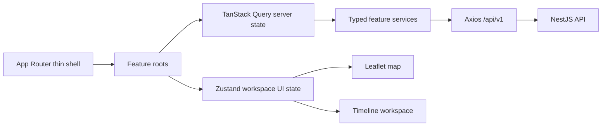
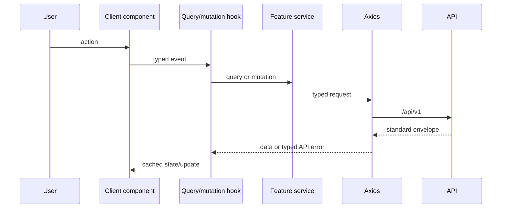
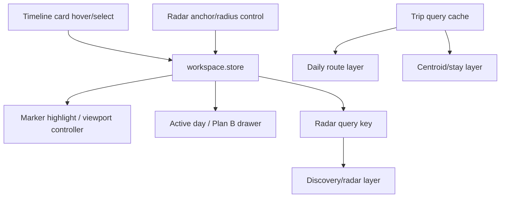
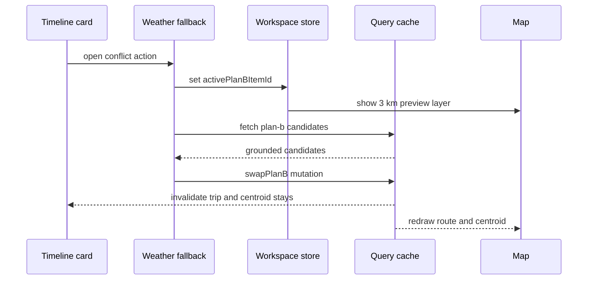

Write ARCHITECTURE.md for Frontend (Feature-based Next.js App Router) based on:

# SkyRoute Frontend Architecture

## Overview

The frontend is a feature-based Next.js 15 application. App Router routes provide SEO, layouts, metadata, loading, and error boundaries; self-contained features deliver the interactive travel workspace. Server components render public shells; client islands handle maps, drag-and-drop, forms, and synchronized workspace UI.



| Technology | Architectural role |
|---|---|
| Next.js App Router | SEO/public rendering, route composition, metadata, loading/error boundaries |
| TypeScript strict mode | contract safety for API payloads, IDs, coordinates, and slots |
| TanStack Query v5 | API cache, mutations, optimistic timeline updates, invalidation |
| Zustand | low-latency map/timeline UI synchronization only |
| React Leaflet | client-only map layers on OpenStreetMap |
| `@dnd-kit` | accessible four-slot timeline sorting |
| Tailwind + shadcn/ui | shared design primitives, drawers, dialogs, feedback |

## Runtime structure

```text
src/
├── app/
│   ├── layout.tsx                  # fonts and root providers
│   ├── providers.tsx               # QueryClient, theme, toast providers
│   ├── (marketing)/                # / and /explore/[city]
│   ├── (auth)/                     # /login and /register
│   └── (workspace)/trips/          # /trips and /trips/[tripId]
├── config/                         # typed public env and constants
├── shared/
│   ├── components/{ui,feedback,layout}/
│   ├── hooks/                      # browser-neutral reusable hooks
│   ├── lib/                        # Axios, query client, routes
│   ├── stores/workspace.store.ts
│   ├── types/                      # API envelope, geo, pagination
│   └── utils/                      # formatting and weather display helpers
├── features/
│   ├── auth/ discovery/ itinerary-planner/
│   ├── weather-fallback/ stay-finder/ ai-copilot/
└── assets/{markers,images}/
```

`src/app/` imports only feature public barrels and shared layout primitives. Feature internals are never imported across feature boundaries.

## Route composition

| Route | Rendering role | Feature root |
|---|---|---|
| `/` | public, server-rendered landing and quick explorer | marketing/discovery entry |
| `/explore/[city]` | public city guide with metadata | discovery and stays views |
| `/login`, `/register` | public auth forms | auth |
| `/trips` | authenticated trip dashboard | itinerary-planner |
| `/trips/[tripId]` | protected split workspace | itinerary-planner + discovery |

```tsx
// app/(workspace)/trips/[tripId]/page.tsx
import { TripWorkspace } from '@/features/itinerary-planner';

export default async function Page({ params }: { params: Promise<{ tripId: string }> }) {
  const { tripId } = await params;
  return <TripWorkspace tripId={Number(tripId)} />;
}
```

The workspace composition may use the discovery public map export, but the route itself owns no query, mutation, or map logic.

## Feature anatomy

```text
features/discovery/
├── components/
│   ├── InteractiveMap.tsx          # dynamic client-only map export
│   ├── MapCanvas.tsx               # Leaflet MapContainer and layers
│   ├── MapViewportController.tsx   # selector-driven flyTo/fitBounds
│   ├── ProximityRadarControl.tsx
│   └── MultiLayerFilterBar.tsx
├── hooks/{usePlaces,useRadarPlaces,useWeatherFood}.ts
├── services/discovery.service.ts
├── types/discovery.types.ts
└── index.ts
```

The same anatomy applies to other features. `itinerary-planner` owns `TimelineBoard`, slot columns, route polylines, and reorder hooks. `weather-fallback` owns forecast badges and Plan B UI. `stay-finder` owns centroid pin/drawer. `ai-copilot` owns prompt and proposal UI.

## API and data flow



`shared/lib/axios.ts` uses `/api/v1`, `withCredentials`, attaches the access token, refreshes once on `AUTH_002`, and unwraps `{ code, message, details }`. Feature services expose typed methods; hooks define query keys and invalidation. Components do not issue HTTP calls directly.

### Query-key ownership

| Data | Query key | Invalidate after |
|---|---|---|
| Trip detail | `['trip', tripId]` | item create, reorder, edit, removal, weather sync, Plan B swap |
| Centroid stays | `['centroid-stays', tripId]` | any selected place mutation or Plan B swap |
| Radar places | `['radar-places', filters]` | filter/anchor/radius change |
| Plan B candidates | `['plan-b', tripId, itemId]` | weather sync or completed swap |
| Weather forecast | `['weather', city, date]` | explicit refresh only |

## State and map/timeline synchronization



Zustand contains `hoveredPlaceId`, `selectedItemId`, `activeDayNumber`, `radarAnchorCoords`, `radarRadiusKm`, and `activePlanBItemId`. It never owns API responses. URL search params hold shareable view state such as `day`, `mode`, `radius`, and `category`.

`MapCanvas` has four isolated layers: discovery/radar circle and POIs; active-day route polylines; 3 km Plan B candidate preview; and centroid/stay pins. Custom markers are memoized. `MapViewportController` subscribes to granular selectors so the container is not remounted during hover events.

## Optimistic timeline reorder

1. `TimelineBoard` uses `<DndContext id="skyroute-timeline-dnd">` and computes the complete reorder payload.
2. `useReorderTimeline` snapshots `['trip', tripId]` in `onMutate` and updates the cache so the card snaps immediately.
3. The service sends `PATCH /trips/:id/items/reorder`.
4. On error, the hook restores the snapshot and displays an actionable toast; on settlement it invalidates trip and centroid-stay keys.
5. The response redraws route warnings, weather badges, and centroid pin from server truth.

## Plan B interaction



Render the conflict action only when the API provides `isOutdoor && rainProbability >= 60`. The swap drawer treats candidates as server data; it never derives or invents replacement locations in the browser.

## Rendering, accessibility, and resiliency

- Leaflet is loaded through `next/dynamic(..., { ssr: false })`; no server component imports it.
- Interactive leaves use `'use client'`; public route shells preserve server rendering and metadata.
- Each panel has loading, empty, error, and retry states. A map error is isolated from the timeline through panel-level boundaries.
- Drawers, dialogs, DnD controls, and map-adjacent controls provide labels, keyboard interaction, visible focus, and mobile-safe layout.
- On narrow screens, the timeline remains primary and map/drawer navigation stays reachable without horizontal overflow.

## Contract change procedure

1. Update [API_SPEC.md](../share/API_SPEC.md) before changing a feature service or typed response.
2. Update Zod schemas, TypeScript types, service methods, hooks, and tests in the same feature slice.
3. Add query invalidation if the mutation changes another feature's derived data.
4. Update [FE-PROJECT-RULES.md](FE-PROJECT-RULES.md) or `CONTEXT.md` when the architecture rule or local decision changes.
