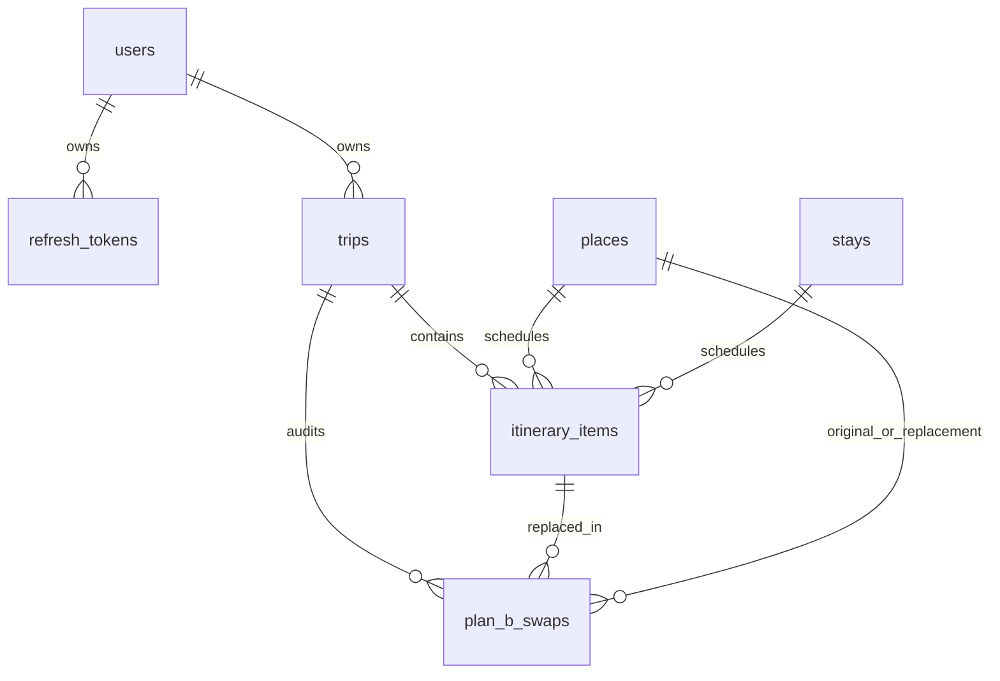

Write DATABASE.md based on the project context above.

# SkyRoute Database Schema

## Overview

- **Primary store:** PostgreSQL 16 with PostGIS 3.4. Enable it in the first migration with `CREATE EXTENSION IF NOT EXISTS postgis;`.
- **Cache:** Redis 7. Weather forecasts are cached for 30 minutes; Redis is not the source of truth for persisted data.
- **ORM:** TypeORM with parameterized spatial SQL. Do not use `synchronize: true` outside local unit tests.
- **Conventions:** plural `snake_case` tables; `snake_case` columns; `BIGINT` identity primary keys; `TIMESTAMPTZ` timestamps; foreign keys named `<singular>_id`.
- **Coordinates:** WGS84 `GEOMETRY(Point, 4326)`. API payloads use `{ lat, lng }`, but PostGIS always receives `ST_MakePoint(lng, lat)`.

## Feature ownership

| Feature | Tables | Responsibility |
|---|---|---|
| `auth` | `users`, `refresh_tokens` | Account profile and multi-device JWT refresh sessions |
| `discovery` | `places` | POIs, food venues, and spatial radar data |
| `stays` | `stays` | Accommodation catalogue and centroid-nearest lookup |
| `trips` | `trips`, `itinerary_items` | Trips and four-slot itinerary timeline |
| `weather` | `weather_snapshots` | Durable forecast fallback for cached/Open-Meteo data |
| `ai-copilot` | `plan_b_swaps` | Auditable indoor Plan B replacements |

## Auth feature

### `users`

| Column | Type | Constraints / purpose |
|---|---|---|
| `id` | `BIGINT` | PK, generated identity |
| `email` | `VARCHAR(255)` | `NOT NULL`, unique, normalized lowercase |
| `password_hash` | `VARCHAR(255)` | `NOT NULL`; bcrypt hash only |
| `full_name` | `VARCHAR(150)` | `NOT NULL` |
| `avatar_url` | `TEXT` | nullable |
| `preferences` | `JSONB` | `NOT NULL DEFAULT '{}'::jsonb` |
| `is_active` | `BOOLEAN` | `NOT NULL DEFAULT TRUE`; soft-delete/access flag |
| `created_at`, `updated_at` | `TIMESTAMPTZ` | `NOT NULL DEFAULT CURRENT_TIMESTAMP` |

Indexes: unique `uq_users_email` on `email`; `idx_users_active` on `is_active`.

### `refresh_tokens`

| Column | Type | Constraints / purpose |
|---|---|---|
| `id` | `BIGINT` | PK, generated identity |
| `user_id` | `BIGINT` | FK → `users(id)` `ON DELETE CASCADE` |
| `token_hash` | `CHAR(64)` | `NOT NULL`, unique SHA-256 hash; never store the raw token |
| `device_name` | `VARCHAR(255)` | nullable |
| `ip_address` | `INET` | nullable |
| `user_agent` | `TEXT` | nullable |
| `expires_at` | `TIMESTAMPTZ` | `NOT NULL` |
| `is_revoked` | `BOOLEAN` | `NOT NULL DEFAULT FALSE` |
| `created_at` | `TIMESTAMPTZ` | `NOT NULL DEFAULT CURRENT_TIMESTAMP` |

Indexes: `idx_refresh_tokens_user_expires (user_id, expires_at)` and partial `idx_refresh_tokens_active (user_id) WHERE is_revoked = FALSE`.

## Discovery feature

### `places`

| Column | Type | Constraints / purpose |
|---|---|---|
| `id` | `BIGINT` | PK, generated identity |
| `name`, `city` | `VARCHAR(255)`, `VARCHAR(100)` | both `NOT NULL` |
| `category` | `VARCHAR(50)` | `NOT NULL`; `attraction`, `restaurant`, or `cafe` |
| `subcategory` | `VARCHAR(50)` | nullable; e.g. `hotpot`, `bbq`, `museum`, `nature`, `workshop` |
| `is_outdoor`, `has_ac` | `BOOLEAN` | `NOT NULL DEFAULT TRUE`, `NOT NULL DEFAULT FALSE` |
| `suitable_weather` | `VARCHAR(50)[]` | `NOT NULL DEFAULT '{}'`; e.g. `rainy`, `cold`, `hot` |
| `price_level`, `rating` | `SMALLINT`, `NUMERIC(2,1)` | defaults `2`, `4.0`; checks `1..3` and `0..5` |
| `address`, `description`, `thumbnail_url` | `TEXT` | nullable |
| `location` | `GEOMETRY(Point, 4326)` | `NOT NULL`; `@Index({ spatial: true })` |
| `is_active` | `BOOLEAN` | `NOT NULL DEFAULT TRUE` |
| `created_at`, `updated_at` | `TIMESTAMPTZ` | `NOT NULL DEFAULT CURRENT_TIMESTAMP` |

Indexes: `idx_places_location GIST (location)`, `idx_places_location_geography GIST ((location::geography))`, `idx_places_city_category_outdoor (city, category, is_outdoor)`, and `idx_places_suitable_weather GIN (suitable_weather)`.

## Stays feature

### `stays`

| Column | Type | Constraints / purpose |
|---|---|---|
| `id` | `BIGINT` | PK, generated identity |
| `name`, `city` | `VARCHAR(255)`, `VARCHAR(100)` | both `NOT NULL` |
| `stay_type` | `VARCHAR(50)` | `NOT NULL`; `hotel`, `homestay`, or `resort` |
| `price_per_night` | `NUMERIC(12,2)` | `NOT NULL CHECK (price_per_night >= 0)`; VND |
| `rating` | `NUMERIC(2,1)` | `NOT NULL DEFAULT 4.0 CHECK (rating BETWEEN 0 AND 5)` |
| `address`, `thumbnail_url` | `TEXT` | nullable |
| `location` | `GEOMETRY(Point, 4326)` | `NOT NULL`; `@Index({ spatial: true })` |
| `amenities` | `JSONB` | `NOT NULL DEFAULT '[]'::jsonb` |
| `is_active` | `BOOLEAN` | `NOT NULL DEFAULT TRUE` |
| `created_at`, `updated_at` | `TIMESTAMPTZ` | `NOT NULL DEFAULT CURRENT_TIMESTAMP` |

Indexes: `idx_stays_location GIST (location)`, `idx_stays_city_price (city, price_per_night)`, and `idx_stays_active (is_active) WHERE is_active = TRUE`.

## Trips feature

### `trips`

| Column | Type | Constraints / purpose |
|---|---|---|
| `id` | `BIGINT` | PK, generated identity |
| `user_id` | `BIGINT` | FK → `users(id)` `ON DELETE RESTRICT` |
| `title`, `destination_city` | `VARCHAR(255)`, `VARCHAR(100)` | both `NOT NULL` |
| `start_date`, `end_date` | `DATE` | `NOT NULL`; `CHECK (end_date >= start_date)` |
| `status` | `VARCHAR(20)` | `NOT NULL DEFAULT 'active'`; `draft`, `active`, `completed`, `archived` |
| `centroid_location` | `GEOMETRY(Point, 4326)` | nullable; recalculated from itinerary places |
| `created_at`, `updated_at` | `TIMESTAMPTZ` | `NOT NULL DEFAULT CURRENT_TIMESTAMP` |

Indexes: `idx_trips_user_status (user_id, status)` and `idx_trips_destination_dates (destination_city, start_date, end_date)`.

### `itinerary_items`

| Column | Type | Constraints / purpose |
|---|---|---|
| `id` | `BIGINT` | PK, generated identity |
| `trip_id` | `BIGINT` | FK → `trips(id)` `ON DELETE CASCADE` |
| `place_id`, `stay_id` | `BIGINT` | nullable FKs → `places(id)` / `stays(id)`, both `ON DELETE RESTRICT` |
| `day_number`, `order_index` | `SMALLINT` | `NOT NULL CHECK (day_number > 0)` and `CHECK (order_index >= 0)` |
| `time_slot` | `VARCHAR(20)` | `NOT NULL`; `morning`, `lunch`, `afternoon`, `dinner` |
| `distance_from_prev_km` | `NUMERIC(6,2)` | `NOT NULL DEFAULT 0 CHECK (distance_from_prev_km >= 0)` |
| `is_detour_warning` | `BOOLEAN` | `NOT NULL DEFAULT FALSE`; true when distance is over 8 km |
| `weather_condition` | `VARCHAR(50)` | nullable weather tag from the latest sync |
| `temperature_c` | `NUMERIC(4,1)` | nullable |
| `rain_probability` | `SMALLINT` | nullable `CHECK (rain_probability BETWEEN 0 AND 100)` |
| `weather_alert_flag` | `BOOLEAN` | `NOT NULL DEFAULT FALSE`; outdoor and rain probability ≥60 |
| `note` | `TEXT` | nullable |
| `created_at`, `updated_at` | `TIMESTAMPTZ` | `NOT NULL DEFAULT CURRENT_TIMESTAMP` |

Constraints: `CHECK (num_nonnulls(place_id, stay_id) = 1)` guarantees exactly one scheduled activity reference. Indexes: `idx_itinerary_items_trip_day_slot (trip_id, day_number, time_slot, order_index)` and partial `idx_itinerary_items_weather_alert (trip_id) WHERE weather_alert_flag = TRUE`.

## Weather and AI Copilot features

### `weather_snapshots`

| Column | Type | Constraints / purpose |
|---|---|---|
| `id` | `BIGINT` | PK, generated identity |
| `city`, `forecast_date`, `time_slot` | `VARCHAR(100)`, `DATE`, `VARCHAR(20)` | `NOT NULL`; unique together |
| `temperature_c` | `NUMERIC(4,1)` | `NOT NULL` |
| `rain_probability` | `SMALLINT` | `NOT NULL CHECK (rain_probability BETWEEN 0 AND 100)` |
| `weather_code`, `condition_tag` | `SMALLINT`, `VARCHAR(50)` | `NOT NULL` Open-Meteo code and normalized tag |
| `fetched_at` | `TIMESTAMPTZ` | `NOT NULL DEFAULT CURRENT_TIMESTAMP` |

Constraint/index: `uq_weather_snapshots_city_date_slot (city, forecast_date, time_slot)`; it supports deterministic fallback lookup.

### `plan_b_swaps`

| Column | Type | Constraints / purpose |
|---|---|---|
| `id` | `BIGINT` | PK, generated identity |
| `trip_id`, `itinerary_item_id` | `BIGINT` | FKs → `trips(id)`, `itinerary_items(id)`; `NOT NULL`, `ON DELETE CASCADE` |
| `original_place_id`, `replacement_place_id` | `BIGINT` | `NOT NULL` FKs → `places(id)` `ON DELETE RESTRICT` |
| `rain_probability_at_swap` | `SMALLINT` | `NOT NULL CHECK (rain_probability_at_swap BETWEEN 0 AND 100)` |
| `distance_from_prev_km` | `NUMERIC(6,2)` | `NOT NULL CHECK (distance_from_prev_km >= 0)` |
| `created_at` | `TIMESTAMPTZ` | `NOT NULL DEFAULT CURRENT_TIMESTAMP` |

Constraints/indexes: `CHECK (original_place_id <> replacement_place_id)`, `idx_plan_b_swaps_trip_created (trip_id, created_at DESC)`, and `idx_plan_b_swaps_item (itinerary_item_id)`.

## Spatial and lifecycle rules

- Radar uses `ST_DWithin(p.location::geography, anchor::geography, :radius_meters)`. The functional geography GIST index above is required; the geometry GIST index alone does not index that cast.
- Centroids use `ST_Centroid(ST_Collect(p.location))` after a transaction adds, removes, reorders, or swaps a place. `stays.location <-> centroid` performs KNN candidate ordering; return meter distances with `ST_DistanceSphere`.
- Compute same-day route distance with `ST_DistanceSphere(prev.location, curr.location) / 1000.0`; set `is_detour_warning` when it exceeds 8 km.
- Plan B candidates must be active indoor places, support rainy weather, and be within 3,000 m of the preceding stop. Plan B swap, audit insertion, distance recalculation, and centroid update run in one transaction.
- Soft-delete only `users`, `places`, and `stays` through `is_active`; do not delete referenced catalog records. Refresh sessions are revoked with `is_revoked`.

## Redis keys

| Key | Value / TTL | Purpose |
|---|---|---|
| `weather:hourly:{city}:{yyyy-mm-dd}` | Open-Meteo hourly JSON / `1800s` | Prevent duplicate provider calls |
| `trip:centroid:{trip_id}` | `{ lat, lng, updatedAt }` / `3600s` | Accelerate centroid-stay lookup; invalidate after itinerary changes |
| `rate-limit:{scope}:{subject}` | counter / policy TTL | API rate limiting |

## Migration rules

- Name migrations `[timestamp]_[description].ts`; e.g. `1710000000000_enable_postgis_and_init_schema.ts`.
- Every migration implements reversible `up` and `down` methods. Test both directions before merging.
- TypeORM maps points with `@Column({ type: 'geometry', spatialFeatureType: 'Point', srid: 4326 })`; create spatial and functional indexes explicitly in migrations.
