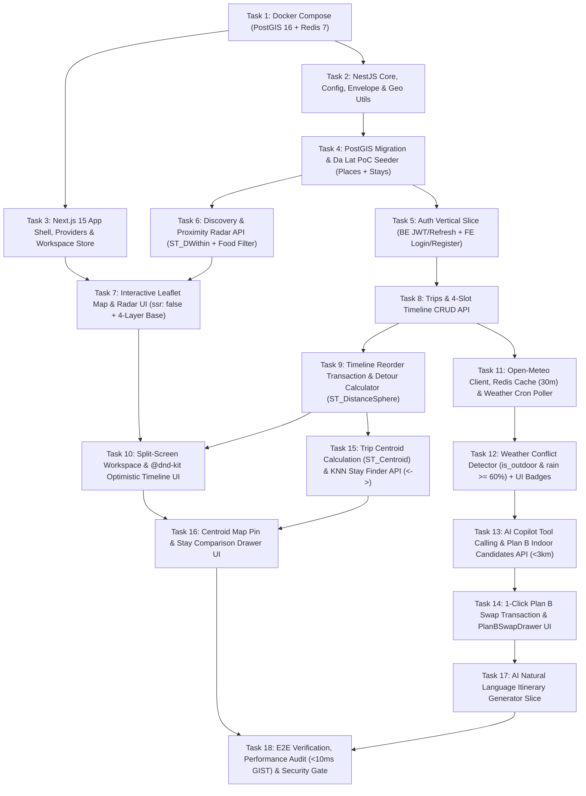

# Implementation Plan: SkyRoute (Smart Travel Companion)

> **Skill Applied:** `planning-and-task-breakdown`
> **Source Specs:** [AGENT.md](../AGENT.md), [share/Readme.md](../share/Readme.md), [share/DATABASE.md](../share/DATABASE.md), [share/API_SPEC.md](../share/API_SPEC.md), [backend/BE-ARCHITECTURE.md](../backend/BE-ARCHITECTURE.md), [frontend/FE-ARCHITECTURE.md](../frontend/FE-ARCHITECTURE.md)

---

## 1. Overview

**SkyRoute** is a context-aware, weather-adaptive travel recommendation and itinerary planning platform. Instead of building horizontal layers in isolation, this plan breaks the project into **5 phases (18 small/medium vertical tasks)** with verification checkpoints between every phase. We first establish the PostGIS + Redis infrastructure and canonical documentation, then deliver vertical slices for **Spatial Discovery & Proximity Radar**, **Interactive 4-Slot Timeline Planner**, **Hourly Weather Sync & 1-Click Indoor Plan B Swap**, and **Trip Centroid Stay Finder**.

---

## 2. Architecture Decisions

1. **Feature-Based Modular Monolith (BE & FE):**
   - Backend (`backend/src/features/`) and Frontend (`frontend/src/features/`) are organized by domain feature (`auth`, `discovery`, `stays`, `trips`, `weather`, `ai-copilot`), not technical layers.
2. **PostGIS Spatial Engine with Strict `(lng, lat)` Guardrail:**
   - All coordinates use WGS84 (`GEOMETRY(Point, 4326)`) indexed with `GIST`. `geo.util.ts` enforces `ST_SetSRID(ST_MakePoint(lng, lat), 4326)` so longitude and latitude are never swapped.
3. **Next.js 15 Thin App Router Shell + Client Islands:**
   - `frontend/src/app/` only handles routing and metadata (`< 50` lines per `page.tsx`). `react-leaflet` is dynamically imported via `next/dynamic(..., { ssr: false })` to prevent SSR `window` crashes.
4. **Grounded AI Function Calling (Zero Hallucination):**
   - The AI Copilot (`ai-copilot`) never fabricates places; it invokes internal tools (`get_places_by_radius`, `get_weather_forecast`) and only recommends existing `place_id` records from PostgreSQL.
5. **High-Frequency Map $\leftrightarrow$ Timeline Synchronization:**
   - Server data lives in **TanStack Query v5** (with `onMutate` optimistic updates for `@dnd-kit` drag-and-drop), while cross-panel selection/hover state lives in **Zustand (`workspace.store.ts`)**.

---

## 3. Dependency Graph

---

## 4. Detailed Task Breakdown

### Phase 1: Foundation & Spatial Infrastructure

#### Task 1: Docker Infrastructure (PostgreSQL 16 + PostGIS 3.4 & Redis 7)
**Description:** Set up root `docker-compose.yml` and `.env.example` files providing PostgreSQL 16 with the `postgis/postgis:16-3.4` image and Redis 7 with healthchecks and persistent volumes.
**Acceptance criteria:**
- [ ] `docker compose up -d` starts `skyroute-postgres` (port 5432) and `skyroute-redis` (port 6379) cleanly.
- [ ] Running `SELECT PostGIS_Full_Version();` inside PostgreSQL succeeds.
- [ ] `REDIS_CLI ping` returns `PONG`.
**Verification:**
- [ ] Manual check: `docker compose ps` shows healthy status for both containers.
**Dependencies:** None
**Files likely touched:**
- `docker-compose.yml`
- `.env.example`
**Estimated scope:** Small (2 files)

---

#### Task 2: Backend Bootstrap, Core Modules & Geo/Response Utilities
**Description:** Initialize the NestJS v11 project in `backend/`, configure `@nestjs/config`, `TypeOrmModule` (PostGIS), `RedisModule`, global `ValidationPipe`, `TransformInterceptor` (`{ success, data, meta }`), `AllExceptionsFilter`, and `shared/utils/geo.util.ts` (`toWktPoint` enforcing `lng, lat` order).
**Acceptance criteria:**
- [ ] NestJS server boots on `/api/v1/health` returning standardized `{ success: true, data: { status: "ok" } }`.
- [ ] `geo.util.spec.ts` verifies `toWktPoint({ lat: 11.9404, lng: 108.4583 })` outputs `POINT(108.4583 11.9404)` (longitude first).
- [ ] Domain errors format to `{ success: false, error: { code, message, details } }`.
**Verification:**
- [ ] Tests pass: `npm --prefix backend run test -- geo.util.spec.ts`
- [ ] Build succeeds: `npm --prefix backend run build`
**Dependencies:** Task 1
**Files likely touched:**
- `backend/src/main.ts`
- `backend/src/app.module.ts`
- `backend/src/shared/utils/geo.util.ts`
- `backend/src/shared/interceptors/transform.interceptor.ts`
- `backend/src/shared/filters/all-exceptions.filter.ts`
**Estimated scope:** Medium (5 files)

---

#### Task 3: Frontend Next.js 15 App Shell, Providers & Workspace Sync Store
**Description:** Initialize Next.js 15 (App Router, TypeScript, Tailwind CSS, `shadcn/ui`) in `frontend/`, set up `QueryClientProvider`, Axios client (`shared/lib/axios.ts`), type-safe `ROUTES` constants, and `shared/stores/workspace.store.ts` (Zustand state for Map $\leftrightarrow$ Timeline synchronization).
**Acceptance criteria:**
- [ ] Next.js app builds and serves `/` and `/trips/[tripId]` shell layout without TypeScript or hydration errors.
- [ ] `workspace.store.ts` exposes `hoveredPlaceId`, `activeDayNumber`, `activeSlot`, `radarAnchorCoords`, `radarRadiusKm`, and `activePlanBItemId`.
- [ ] `workspace.store.test.ts` passes unit tests for state transitions.
**Verification:**
- [ ] Tests pass: `npm --prefix frontend run test -- workspace.store.test.ts`
- [ ] Build succeeds: `npm --prefix frontend run build`
**Dependencies:** None (Can run in parallel with Task 2)
**Files likely touched:**
- `frontend/src/app/layout.tsx`
- `frontend/src/app/providers.tsx`
- `frontend/src/shared/lib/axios.ts`
- `frontend/src/shared/lib/routes.ts`
- `frontend/src/shared/stores/workspace.store.ts`
**Estimated scope:** Medium (5 files)

---

#### Task 4: PostGIS Core Schema Migration & Da Lat PoC Seeder
**Description:** Create the initial reversible TypeORM migration enabling `postgis` and creating all 6 core tables (`users`, `refresh_tokens`, `places`, `stays`, `trips`, `itinerary_items`, `weather_snapshots`, `plan_b_swaps`) with `GIST` (`idx_places_location`, `idx_stays_location`) and `GIN` (`idx_places_suitable_weather`) indexes, plus a Seeder script populating Da Lat PoC data (~50 attractions/cafes, ~70 restaurants, ~40 stays).
**Acceptance criteria:**
- [ ] Migration runs `up` and `down` cleanly without errors.
- [ ] `EXPLAIN ANALYZE` on a spatial `ST_DWithin` query over `places` confirms index scan on `idx_places_location`.
- [ ] Seeder populates realistic Da Lat indoor/outdoor attractions, hotpot/BBQ/AC eateries, and homestays/hotels with accurate WGS84 coordinates.
**Verification:**
- [ ] Tests pass: `npm --prefix backend run migration:run && npm --prefix backend run seed`
- [ ] Manual check: Verify `SELECT count(*) FROM places;` and `SELECT count(*) FROM stays;` return seeded records.
**Dependencies:** Task 1, Task 2
**Files likely touched:**
- `backend/src/core/database/migrations/1710000000000-InitPostgisSchema.ts`
- `backend/src/features/discovery/entities/place.entity.ts`
- `backend/src/features/stays/entities/stay.entity.ts`
- `backend/src/features/trips/entities/trip.entity.ts`
- `backend/src/core/database/seeds/dalat.seeder.ts`
**Estimated scope:** Medium (5 files)

### Checkpoint 1: Foundation & Spatial DB Ready
- [ ] Docker containers healthy, PostGIS schema migrated, and Da Lat dataset seeded
- [ ] Both `backend` and `frontend` build with zero TypeScript errors
- [ ] Review with human before proceeding to Phase 2

---

### Phase 2: Auth & Spatial Discovery (Proximity Radar)

#### Task 5: Auth Feature Vertical Slice (BE Multi-Device JWT + FE Auth Pages)
**Description:** Implement `features/auth` on Backend (`POST /auth/register`, `/auth/login`, `/auth/refresh`, `/auth/logout`, `JwtAuthGuard`, hashed `refresh_tokens`) and Frontend (`LoginForm`, `RegisterForm`, `auth.store.ts`, Axios 401 refresh interceptor).
**Acceptance criteria:**
- [ ] User can register, log in, receive `accessToken` + `httpOnly` refresh cookie, and fetch `GET /api/v1/auth/me`.
- [ ] Expired access token triggers automatic silent refresh via `/auth/refresh`.
- [ ] Auth service unit tests cover invalid credentials (`AUTH_001`) and duplicate email (`AUTH_005`).
**Verification:**
- [ ] Tests pass: `npm --prefix backend run test -- auth.service.spec.ts`
- [ ] Build succeeds: `npm --prefix backend run build && npm --prefix frontend run build`
**Dependencies:** Task 2, Task 3, Task 4
**Files likely touched:**
- `backend/src/features/auth/auth.service.ts`
- `backend/src/features/auth/auth.controller.ts`
- `frontend/src/features/auth/components/LoginForm.tsx`
- `frontend/src/features/auth/stores/auth.store.ts`
**Estimated scope:** Medium (4-5 files)

---

#### Task 6: Spatial Discovery & Proximity Radar Backend (`discovery`)
**Description:** Implement `PlaceRepository` and `DiscoveryService` in `backend/src/features/discovery/` for `GET /api/v1/places`, `GET /api/v1/places/radar` (PostGIS `ST_DWithin` $1\text{km}-5\text{km}$ + `ST_DistanceSphere`), and `GET /api/v1/places/food-recommendations` (matching temperature/rain to `hotpot`/`bbq` vs `has_ac`/`refreshment`).
**Acceptance criteria:**
- [ ] `GET /api/v1/places/radar?lat=11.9404&lng=108.4583&radius_km=3` returns places within $3\text{km}$ sorted by `distanceKm` with `meta.anchorPoint`.
- [ ] Out-of-range radius ($<1$ or $>5$) throws `DISC_003` (`400 Bad Request`).
- [ ] Unit and integration tests verify indoor/outdoor, category, and weather-tag filtering.
**Verification:**
- [ ] Tests pass: `npm --prefix backend run test -- discovery.service.spec.ts`
- [ ] Manual check: Query `/api/v1/places/radar` on seeded Da Lat data and confirm execution `< 10ms`.
**Dependencies:** Task 4
**Files likely touched:**
- `backend/src/features/discovery/repositories/place.repository.ts`
- `backend/src/features/discovery/services/discovery.service.ts`
- `backend/src/features/discovery/discovery.controller.ts`
- `backend/src/features/discovery/dto/radar-query.dto.ts`
- `backend/src/features/discovery/tests/discovery.service.spec.ts`
**Estimated scope:** Medium (5 files)

---

#### Task 7: Interactive Leaflet Map & Proximity Radar UI (`frontend/features/discovery`)
**Description:** Implement the client-only Leaflet map (`InteractiveMap.tsx` using `next/dynamic` with `ssr: false`), `MapCanvas.tsx`, `MapViewportController.tsx` (subscribing to `workspace.store`), `ProximityRadarControl.tsx` ($1\text{km}-5\text{km}$ slider + `<Circle>` overlay), and `MultiLayerFilterBar.tsx`.
**Acceptance criteria:**
- [ ] Map renders OpenStreetMap tiles in Next.js 15 without SSR `window is not defined` errors.
- [ ] Adjusting the Radar slider ($1\text{km}-5\text{km}$) or clicking a new anchor point on the map updates the `<Circle>` overlay and fetches matching POIs via `useRadarPlaces`.
- [ ] Markers are memoized (`React.memo`) and differentiated by category (`attraction`, `restaurant`, `cafe`) and indoor/outdoor badge.
**Verification:**
- [ ] Tests pass: `npm --prefix frontend run test -- MultiLayerFilterBar.test.tsx`
- [ ] Build succeeds: `npm --prefix frontend run build`
**Dependencies:** Task 3, Task 6
**Files likely touched:**
- `frontend/src/features/discovery/components/InteractiveMap.tsx`
- `frontend/src/features/discovery/components/MapCanvas.tsx`
- `frontend/src/features/discovery/components/MapViewportController.tsx`
- `frontend/src/features/discovery/components/ProximityRadarControl.tsx`
- `frontend/src/features/discovery/hooks/useRadarPlaces.ts`
**Estimated scope:** Medium (5 files)

### Checkpoint 2: Auth & Spatial Radar Complete
- [ ] Users can log in, explore Da Lat on the interactive Leaflet map, filter Indoor/Outdoor & Food types, and scan a $1\text{km}-5\text{km}$ Proximity Radar
- [ ] Zero SSR errors on Next.js build; Backend unit tests pass

---

### Phase 3: Interactive 4-Slot Timeline Planner & Detour Alerts

#### Task 8: Trips CRUD & Slot Item Management Backend (`trips`)
**Description:** Implement `TripRepository`, `ItineraryItemRepository`, and `TripsService` for creating trips (`POST /api/v1/trips`), fetching full trip timelines (`GET /api/v1/trips/:id`), and adding/removing items across the 4 daily slots (`morning`, `lunch`, `afternoon`, `dinner`), protected by `TripOwnerGuard`.
**Acceptance criteria:**
- [ ] User can create a multi-day trip (e.g., 3D2N Da Lat) and add places to specific `(dayNumber, timeSlot)` slots.
- [ ] Non-owners receive `403 AUTH_004` when accessing or mutating another user's trip.
- [ ] Invalid date ranges (`endDate < startDate`) return `400 TRIP_002`.
**Verification:**
- [ ] Tests pass: `npm --prefix backend run test -- trips.service.spec.ts`
- [ ] Build succeeds: `npm --prefix backend run build`
**Dependencies:** Task 5, Task 6
**Files likely touched:**
- `backend/src/features/trips/repositories/trip.repository.ts`
- `backend/src/features/trips/repositories/itinerary-item.repository.ts`
- `backend/src/features/trips/services/trips.service.ts`
- `backend/src/features/trips/trips.controller.ts`
- `backend/src/features/trips/tests/trips.service.spec.ts`
**Estimated scope:** Medium (5 files)

---

#### Task 9: Batch Timeline Reorder Transaction & Route Detour Calculator (`trips`)
**Description:** Implement `TimelineService.reorderItems()` (`PATCH /api/v1/trips/:id/items/reorder`) inside a DB transaction (`QueryRunner`) that updates `(dayNumber, timeSlot, orderIndex)`, computes consecutive point-to-point distances via `ST_DistanceSphere`, flags `is_detour_warning = true` if distance $> 8.0\text{km}$, updates `trips.centroid_location`, and emits `trip.items.changed`.
**Acceptance criteria:**
- [ ] Reordering items across slots or days updates `order_index` and recalculates `distance_from_prev_km` for every stop in the affected day(s).
- [ ] Any consecutive stop pair $> 8.0\text{km}$ apart sets `isDetourWarning: true`.
- [ ] `trips.centroid_location` is atomically updated via `ST_Centroid(ST_Collect(location))`.
**Verification:**
- [ ] Tests pass: `npm --prefix backend run test -- timeline.service.spec.ts`
- [ ] Manual check: Reorder two distant Da Lat stops (e.g., Langbiang -> Đồi Chè Cầu Đất) and verify `isDetourWarning: true` (`> 8km`).
**Dependencies:** Task 8
**Files likely touched:**
- `backend/src/features/trips/services/timeline.service.ts`
- `backend/src/features/trips/dto/reorder-itinerary.dto.ts`
- `backend/src/features/trips/tests/timeline.service.spec.ts`
**Estimated scope:** Small-Medium (3 files)

---

#### Task 10: Split-Screen Planner Workspace, `@dnd-kit` Timeline & Route Polyline UI
**Description:** Build `TimelineBoard.tsx` (`<DndContext id="skyroute-timeline-dnd">`), `TimeSlotColumn.tsx` (4 slots/day), `TimelineItemCard.tsx` (showing distance & orange detour badge), `useReorderTimeline.ts` (with TanStack Query `onMutate` optimistic updates), and `DailyRoutePolyline.tsx` on the map (solid line for normal route, dashed red/orange line when `isDetourWarning === true`).
**Acceptance criteria:**
- [ ] Dragging a card between `Morning`, `Lunch`, `Afternoon`, and `Dinner` snaps immediately via optimistic update and persists via `PATCH /trips/:id/items/reorder`.
- [ ] Hovering a timeline card highlights its marker on the Leaflet map via `workspace.store`.
- [ ] Consecutive stops with `isDetourWarning = true` display a warning badge on the card and a dashed red polyline on the map.
**Verification:**
- [ ] Tests pass: `npm --prefix frontend run test -- TimelineItemCard.test.tsx`
- [ ] Build succeeds: `npm --prefix frontend run build`
**Dependencies:** Task 7, Task 9
**Files likely touched:**
- `frontend/src/app/(workspace)/trips/[tripId]/page.tsx`
- `frontend/src/features/itinerary-planner/components/TimelineBoard.tsx`
- `frontend/src/features/itinerary-planner/components/TimelineItemCard.tsx`
- `frontend/src/features/itinerary-planner/components/DailyRoutePolyline.tsx`
- `frontend/src/features/itinerary-planner/hooks/useReorderTimeline.ts`
**Estimated scope:** Medium (5 files)

### Checkpoint 3: Interactive Drag & Drop Timeline Complete
- [ ] Split-screen workspace (`/trips/[tripId]`) synchronizes the 4-slot Drag & Drop Timeline with the Leaflet Map and Route Polylines
- [ ] Detour warnings trigger accurately when consecutive stops exceed $8\text{km}$

---

### Phase 4: Weather Synchronization & AI 1-Click "Plan B" Fallback

#### Task 11: Open-Meteo Integration, Redis 30m Cache & Hourly Cron Poller (`weather`)
**Description:** Implement `OpenMeteoClient` (`core/integrations/open-meteo.client.ts`) and `WeatherService` / `WeatherPollerService` (`@Cron(CronExpression.EVERY_30_MINUTES)`) that fetches hourly temperature & precipitation probability, caches in Redis (`weather:hourly:{city}:{date}`, `TTL = 1800s`), falls back to `weather_snapshots` table on network failure, and aggregates metrics into the 4 daily slots.
**Acceptance criteria:**
- [ ] `GET /api/v1/weather/forecast?city=Da%20Lat&date=2026-11-20` returns aggregated forecast for `morning`, `lunch`, `afternoon`, and `dinner`.
- [ ] Second call within 30 minutes hits Redis cache (`< 5ms`) without calling Open-Meteo.
- [ ] If Open-Meteo times out, service gracefully falls back to `weather_snapshots`.
**Verification:**
- [ ] Tests pass: `npm --prefix backend run test -- weather.service.spec.ts`
- [ ] Build succeeds: `npm --prefix backend run build`
**Dependencies:** Task 2, Task 4
**Files likely touched:**
- `backend/src/core/integrations/open-meteo.client.ts`
- `backend/src/features/weather/services/weather.service.ts`
- `backend/src/features/weather/services/weather-poller.service.ts`
- `backend/src/features/weather/weather.controller.ts`
- `backend/src/features/weather/tests/weather.service.spec.ts`
**Estimated scope:** Medium (5 files)

---

#### Task 12: Automatic Weather Conflict Detection & Slot Weather UI Badges
**Description:** Connect `WeatherService` to `TripsService` (`POST /api/v1/trips/:id/weather-sync` and `trip.items.changed` listener) to automatically set `weather_alert_flag = true` whenever an item has `place.is_outdoor === true` and `rain_probability >= 60%`. Render `SlotWeatherBadge.tsx` and `WeatherConflictBanner.tsx` on the Frontend timeline.
**Acceptance criteria:**
- [ ] Outdoor activity in a slot with `rain_probability >= 60` receives `weatherAlertFlag: true`; indoor activity in the same slot remains `weatherAlertFlag: false`.
- [ ] Frontend timeline renders temperature, rain %, and a prominent red conflict alert button (**"Cảnh báo mưa lớn — Tìm Kế hoạch B Indoor"**) on conflicted cards.
**Verification:**
- [ ] Tests pass: `npm --prefix backend run test -- weather-conflict.spec.ts` and `npm --prefix frontend run test -- WeatherConflictBanner.test.tsx`
**Dependencies:** Task 10, Task 11
**Files likely touched:**
- `backend/src/features/weather/services/weather-conflict.service.ts`
- `frontend/src/features/weather-fallback/components/SlotWeatherBadge.tsx`
- `frontend/src/features/weather-fallback/components/WeatherConflictBanner.tsx`
**Estimated scope:** Small-Medium (3 files)

---

#### Task 13: AI Copilot Function Calling & Plan B Indoor Candidates API (`ai-copilot`)
**Description:** Implement `LlmToolClient` (`core/integrations/llm-tool.client.ts`), `ContextualRankingService` ($Score = w_1\text{Pref} + w_2\text{Weather} + w_3\text{Dist} + w_4\text{Rating}$), and `PlanBService.getCandidates()` (`GET /api/v1/trips/:id/items/:itemId/plan-b-candidates`) to query PostGIS for the top 2–3 indoor places (`is_outdoor = false`) within $3\text{km}$ of the preceding slot's location, enriched with grounded AI explanations.
**Acceptance criteria:**
- [ ] Returns 2–3 indoor (`isOutdoor: false`) candidates within $3\text{km}$ of the previous stop, ranked by `contextualScore`.
- [ ] Every candidate is a verified record from the `places` table (100% grounded, zero hallucinated places).
- [ ] If no indoor place exists within $3\text{km}$, throws `AI_001` (`422 Unprocessable Entity`).
**Verification:**
- [ ] Tests pass: `npm --prefix backend run test -- plan-b.service.spec.ts`
- [ ] Build succeeds: `npm --prefix backend run build`
**Dependencies:** Task 6, Task 12
**Files likely touched:**
- `backend/src/core/integrations/llm-tool.client.ts`
- `backend/src/features/ai-copilot/services/contextual-ranking.service.ts`
- `backend/src/features/ai-copilot/services/plan-b.service.ts`
- `backend/src/features/ai-copilot/ai-copilot.controller.ts`
- `backend/src/features/ai-copilot/tests/plan-b.service.spec.ts`
**Estimated scope:** Medium (5 files)

---

#### Task 14: 1-Click Plan B Swap Transaction & Frontend `PlanBSwapDrawer`
**Description:** Implement `POST /api/v1/trips/:id/items/:itemId/swap-plan-b` on Backend (atomically swapping `place_id`, resetting `weather_alert_flag = false`, logging to `plan_b_swaps`, recalculating route distances and `trips.centroid_location`) and build `PlanBSwapDrawer.tsx` + `PlanBCandidateCard.tsx` + Map $3\text{km}$ preview layer on Frontend.
**Acceptance criteria:**
- [ ] Clicking the red weather alert opens `PlanBSwapDrawer`, draws the $3\text{km}$ indoor search zone on the map, and previews the 2–3 indoor candidates.
- [ ] Clicking **"Hoán đổi 1-Click"** swaps the place on the timeline, clears the red alert, logs a `plan_b_swaps` record, and refreshes the map route and centroid.
**Verification:**
- [ ] Tests pass: `npm --prefix frontend run test -- PlanBSwapDrawer.test.tsx`
- [ ] Manual check: Trigger a Plan B swap on a rainy afternoon slot and verify DB & UI update in one click.
**Dependencies:** Task 13
**Files likely touched:**
- `backend/src/features/ai-copilot/repositories/plan-b-swap.repository.ts`
- `frontend/src/features/weather-fallback/components/PlanBSwapDrawer.tsx`
- `frontend/src/features/weather-fallback/components/PlanBCandidateCard.tsx`
- `frontend/src/features/weather-fallback/hooks/useSwapPlanB.ts`
**Estimated scope:** Medium (4 files)

### Checkpoint 4: Weather Sync & 1-Click Plan B Complete
- [ ] Hourly weather maps to slots, flags outdoor conflicts ($\ge 60\%$ rain), and swaps to nearby indoor alternatives in 1 click

---

### Phase 5: Centroid Stay Finder, AI Generator & Production Polish

#### Task 15: Trip Centroid Stay Finder Backend (`stays`)
**Description:** Implement `StayRepository` and `StaysService.findNearestToTripCentroid()` (`GET /api/v1/trips/:tripId/centroid-stays`) using `ST_Centroid(ST_Collect(p.location))` across the trip's selected places and querying nearest accommodations via the PostGIS GIST-indexed KNN distance operator (`ORDER BY stay.location <-> :centroid LIMIT 10`), including `distanceToCentroidKm` and `avgDistanceToItineraryPlacesKm`.
**Acceptance criteria:**
- [ ] Returns top accommodations ordered by proximity to the geometric centroid $(\bar{x}, \bar{y})$ of the trip's places.
- [ ] Calling on an empty trip with 0 places returns `422 STAY_002`.
- [ ] Unit tests verify centroid coordinates match $\bar{x} = \frac{1}{n}\sum x_i, \bar{y} = \frac{1}{n}\sum y_i$.
**Verification:**
- [ ] Tests pass: `npm --prefix backend run test -- stays.service.spec.ts`
- [ ] Build succeeds: `npm --prefix backend run build`
**Dependencies:** Task 4, Task 9
**Files likely touched:**
- `backend/src/features/stays/repositories/stay.repository.ts`
- `backend/src/features/stays/services/stays.service.ts`
- `backend/src/features/stays/stays.controller.ts`
- `backend/src/features/stays/tests/stays.service.spec.ts`
**Estimated scope:** Medium (4 files)

---

#### Task 16: Centroid Map Pin & Stay Comparison Drawer UI (`frontend/features/stay-finder`)
**Description:** Implement `CentroidMapPin.tsx` (rendering the star marker at $(\bar{x}, \bar{y})$ on the Leaflet map), `CentroidStayDrawer.tsx`, `StayComparisonCard.tsx`, and `useCentroidStays.ts`, plus automatic cache invalidation whenever timeline items change.
**Acceptance criteria:**
- [ ] Toggling **"Gợi ý Lưu trú tại Tâm Chuyến Đi"** flies the map to `centroidLocation`, renders the Centroid Star Pin, and displays ranked hotels/homestays with `distanceToCentroidKm`.
- [ ] Adding, removing, or swapping a timeline stop automatically updates the Centroid Pin position and stay recommendations.
**Verification:**
- [ ] Tests pass: `npm --prefix frontend run test -- StayComparisonCard.test.tsx`
- [ ] Build succeeds: `npm --prefix frontend run build`
**Dependencies:** Task 10, Task 15
**Files likely touched:**
- `frontend/src/features/stay-finder/components/CentroidMapPin.tsx`
- `frontend/src/features/stay-finder/components/CentroidStayDrawer.tsx`
- `frontend/src/features/stay-finder/components/StayComparisonCard.tsx`
- `frontend/src/features/stay-finder/hooks/useCentroidStays.ts`
**Estimated scope:** Medium (4 files)

---

#### Task 17: Grounded AI Itinerary Generator Slice (`POST /api/v1/ai/generate-itinerary`)
**Description:** Implement the natural-language AI Copilot endpoint and UI (`AiPromptModal.tsx`) where users enter preferences (e.g., *"Đà Lạt 3N2Đ thích săn mây, lẩu nướng, ngân sách vừa"*), and the LLM orchestrates `get_places_by_radius` + `get_weather_forecast` via Function Calling to populate a weather-adaptive multi-day itinerary using 100% real PostGIS places.
**Acceptance criteria:**
- [ ] AI generates a multi-day 4-slot itinerary where every item references a valid `place_id` in PostgreSQL and respects slot weather forecasts.
- [ ] Frontend modal previews and applies the generated itinerary directly onto the split-screen workspace.
**Verification:**
- [ ] Tests pass: `npm --prefix backend run test -- ai-copilot.service.spec.ts`
- [ ] Build succeeds: `npm --prefix backend run build && npm --prefix frontend run build`
**Dependencies:** Task 13, Task 14
**Files likely touched:**
- `backend/src/features/ai-copilot/services/ai-copilot.service.ts`
- `backend/src/features/ai-copilot/tools/travel-tools.definition.ts`
- `frontend/src/features/ai-copilot/components/AiPromptModal.tsx`
- `frontend/src/features/ai-copilot/hooks/useGenerateItinerary.ts`
**Estimated scope:** Medium (4 files)

---

#### Task 18: End-to-End Integration Tests, Spatial Performance Benchmark & Quality Gate
**Description:** Run full E2E integration tests on Backend and Frontend, verify `EXPLAIN ANALYZE` `< 10ms` spatial index benchmark on `ST_DWithin` and `<->`, audit security (`security-and-hardening` checklist), and finalize Swagger `/api/docs`.
**Acceptance criteria:**
- [ ] All Backend unit + E2E tests and Frontend Vitest tests pass (`>= 80%` core service coverage).
- [ ] PostGIS `ST_DWithin` radar query executes in `< 10ms` via `GIST` index.
- [ ] Swagger UI is live at `/api/docs` documenting all `/api/v1` endpoints.
**Verification:**
- [ ] Tests pass: `npm --prefix backend run test:e2e && npm --prefix frontend run test`
- [ ] Build succeeds: `npm --prefix backend run build && npm --prefix frontend run build`
**Dependencies:** Tasks 1–17
**Files likely touched:**
- `backend/test/skyroute.e2e-spec.ts`
- `backend/src/main.ts`
**Estimated scope:** Small-Medium (2-3 files)

### Checkpoint 5: Complete MVP Ready for Review
- [ ] All 4 MVP subsystems (Spatial Radar, Drag & Drop Timeline, Weather Plan B Swap, Centroid Stay Finder) + AI Copilot work end-to-end
- [ ] All tests pass and builds succeed cleanly

---

## 5. Parallelization Opportunities

When running with multiple developers or subagents:
- **Track A (Backend Core & Spatial):** Tasks 1 → 2 → 4 → 6 → 8 → 9 → 11 → 13 → 15
- **Track B (Frontend Workspace & Map):** Task 3 → 7 → 10 → 12 (UI) → 14 (UI) → 16 (UI)
- **Can run simultaneously right now:**
  - **Task 1 + Task 2** (Backend & Docker setup) in parallel with **Task 3** (Frontend Next.js 15 App Shell & Zustand store).
  - Once **Task 4** (PostGIS Migration & Seeder) finishes, **Task 5 (Auth)**, **Task 6 (Discovery Radar API)**, and **Task 11 (Weather Poller)** can be developed in parallel because their API contracts are already locked in [share/API_SPEC.md](../share/API_SPEC.md).

---

## 6. Risks and Mitigations

| Risk | Impact | Mitigation |
|---|---|---|
| Swapping `(lat, lng)` order in PostGIS `ST_MakePoint(lng, lat)` | High (wrong locations in Indian Ocean) | Enforce `toWktPoint({ lat, lng })` helper in `geo.util.ts` with unit tests in Task 2 |
| Next.js 15 SSR crash (`window is not defined`) with `react-leaflet` | High (page crash on load) | Strictly load `MapCanvas` via `next/dynamic(..., { ssr: false })` in Task 7 |
| Open-Meteo rate limit or network outage during live demo | Medium | Cache responses in Redis (`TTL = 30m`) and fallback to `weather_snapshots` table + deterministic demo weather seed toggle in Task 11 |
| LLM Hallucinating non-existent Da Lat cafes/addresses | High | Disable free-text place invention; force LLM Function Calling to select only from PostGIS `place_id` results in Task 13 |
| Janky UI during `@dnd-kit` drag-and-drop across slots | Medium | Use TanStack Query `onMutate` optimistic cache updates in Task 10 |

---

## 7. Open Questions

1. **AI Provider Preference:** Do you want to configure **Google Gemini API** (`gemini-2.5-flash` / `gemini-2.5-pro`) as the primary LLM for Function Calling in `backend/.env`, or OpenAI?
2. **Demo Weather Override Mode:** For your thesis defense / live demo, would you like a **"Simulate Heavy Rain (75%)"** toggle button on the UI so you can trigger and demonstrate the **1-Click Plan B Swap** on demand even if the real weather in Da Lat that day is sunny?
